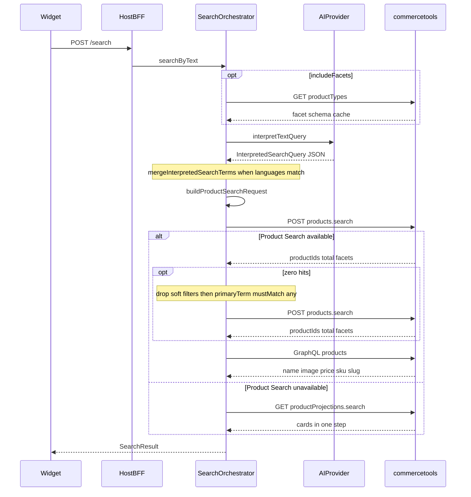
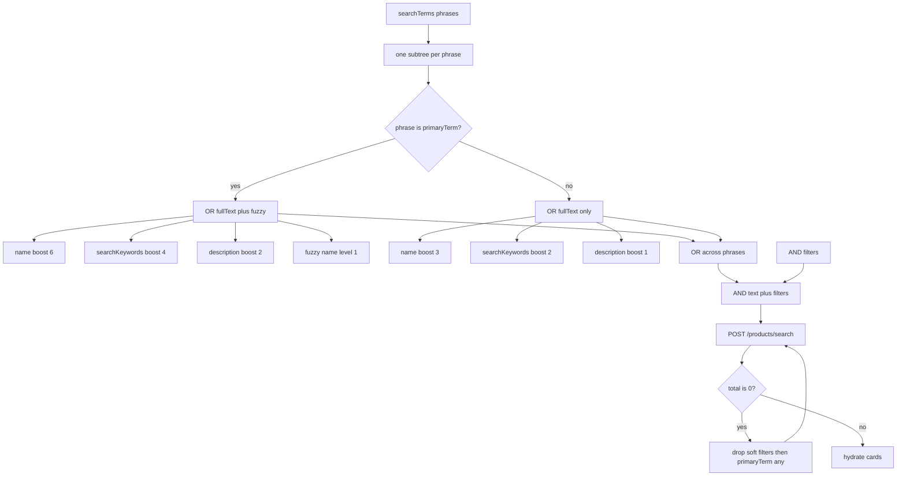
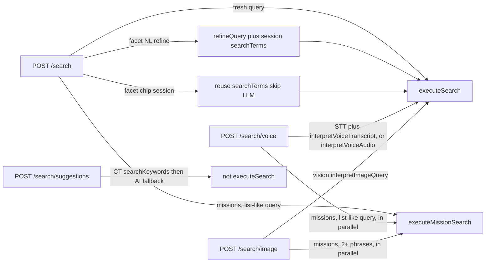
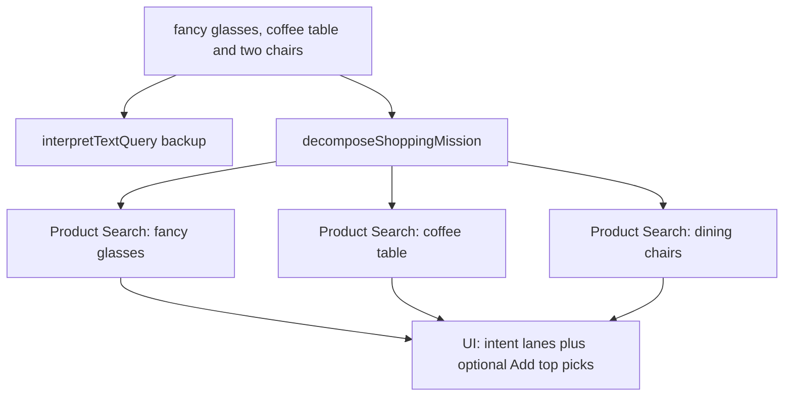

# Search pipeline

How a shopper query travels from the frontend widget to commercetools Product Search. The LLM never emits a commercetools request body: it returns a typed intermediate contract, and a deterministic builder turns that into the API call.

[Documentation index](README.md) · [Configuration](CONFIGURATION.md) · [Observability](OBSERVABILITY.md)

## Trust boundary

The browser never talks to commercetools, OpenRouter/Bedrock, or ElevenLabs. The widget calls only the host BFF.

```
Browser widget  →  Host /api/commerce-ai/*  →  @commerce-ai-tool/server  →  @commerce-ai-tool/core
                                                                              ├─ AI provider
                                                                              └─ commercetools
```

| Layer | Package | Role |
|-------|---------|------|
| Widget | `@commerce-ai-tool/react` or `@commerce-ai-tool/angular` | Collect query, locales, and flags; render cards |
| BFF | Host app using `@commerce-ai-tool/server` | Next.js / Express handlers; keep secrets server-side |
| Orchestrator | `@commerce-ai-tool/core` | Interpret → build query → search → hydrate cards |

Primary sources:

- Widget request: `packages/react/src/hooks/useCommerceAISearch.ts`
- Route body: `packages/server/src/route-actions.ts`
- Pipeline: `packages/core/src/search/orchestrator.ts` (composition root), one module per pipeline next to it: `context.ts` (shared `PipelineContext`: config, AI provider, commercetools client, caches, timeouts, facet schema store), `text-search.ts`, `voice-search.ts`, `image-search.ts`, `suggest.ts`, `product-search.ts` (Product Search call, relaxation, facets) and `mission-search.ts`
- Query builder: `packages/core/src/commercetools/query-builder.ts`

## Locales

Search uses two locales. Mixing them up is the usual source of empty results.

| Field | Purpose | Source |
|-------|---------|--------|
| `queryLocale` | Language the shopper types or speaks. Used as LLM input language and for `interpretation` / TTS. | Widget prop or request body; defaults to `catalogLocale` |
| `catalogLocale` | Language products are indexed in. Used for `fullText.language`, card names, and `searchTerms`. | `CAT_CATALOG_LOCALE` or widget prop |

The model **translates** product keywords into the catalog language. Raw user text is not sent to Product Search except for the same-language passthrough described below.

Resolver: `packages/core/src/locale/resolve.ts`. Env vars and seeding: [configuration](CONFIGURATION.md).

## Text search (happy path)

Fresh `POST /search` with `{ query, queryLocale, catalogLocale, includeFacets?, enableMissions? }`. The request and response shapes of every route are typed in `@commerce-ai-tool/core` and `@commerce-ai-tool/core/client` (see [wire contract types](#wire-contract-types)).



Timeouts (defaults): AI text 15s, commercetools 8s. A timed-out or client-cancelled step aborts its in-flight AI call (OpenRouter); see [AI timeouts, retries, token caps and cancellation](CONFIGURATION.md#ai-timeouts-retries-token-caps-and-cancellation). Optional in-process response cache is keyed on query + sort + locales + limit (see Caches below); results assembled while the request was aborted are not cached.

## LLM interpretation

Prompt name: `commerce-ai/text-query` (`packages/core/src/prompts/index.ts`). Git is the source of truth; Langfuse can serve the same system text at runtime.

The user message includes:

1. `User query language` and `Product catalog language`
2. Optional filterable attribute catalog (from Product Types marked `isSearchable`)
3. The shopper query as `<user_query>"…"</user_query>`: cut to 300 characters, JSON-encoded, with `<` escaped so the text cannot close the tag. Refinements, voice transcripts and the previous search terms and filters of a refinement use the same envelope (`<refine_query>`, `<transcript>`, `<previous_terms>`; caps 300, 2000 and 500 characters). `SAFETY_RULES` tells the model that content inside these tags is data, never instructions.

The model must return JSON only (`InterpretedSearchQuery`):

```json
{
  "primaryTerm": "complete phrase in catalog language",
  "searchTerms": ["complete phrase in catalog language"],
  "filters": [
    { "name": "color", "value": "optional" },
    { "name": "priceMax", "value": "200" }
  ],
  "suggestedFacets": [{ "name": "color", "reason": "shopper mentioned appearance" }],
  "sort": "relevance",
  "interpretation": "brief explanation in queryLocale"
}
```

The parser also accepts the older `filters` object map and stores `InterpretedSearchFilters` as a record.

Rules encoded in the prompt and parser:

- `primaryTerm` is the catalog-language phrase closest to the shopper's intent. Product Search **boosts** it (name 6 / searchKeywords 4 / description 2) above alternates (3 / 2 / 1). Fuzzy matching runs on the primary phrase only.
- Each `searchTerms` element is a **complete phrase**, never split words. `"red shoes"` → `["røde sko"]` for a Norwegian catalog, not `["red","shoes"]`.
- Specific product, brand, or named item → **one phrase** (same as `primaryTerm`). Broad need (something to drink from) → **3–5 hyponym or close-synonym phrases**. Alternates must not be broader hypernyms.
- Parser keeps at most **6** unique phrases (`MAX_INTERPRETED_SEARCH_TERMS`) and always includes `primaryTerm` in `searchTerms`.
- Off-topic queries (general knowledge, jailbreaks) → `searchTerms: []` and a refusal in `interpretation`. The orchestrator then skips commercetools (`hasSearchableContent`).
- Structured constraints go in `filters`, using only attributes from the supplied catalog plus `priceMin` / `priceMax`. Dynamic attributes also support `attributeNameMin` / `attributeNameMax` ranges. `category` is not part of the model's vocabulary: Product Search matches `categories` by category id, which the model cannot know, so the parser drops a model-set `category`. `category` comes only from a categories facet chip, whose bucket key is the id.
- OpenRouter calls use `json_schema` (strict) with `temperature: 0`, falling back to `json_object` when the model answers 400 that json_schema is unsupported. The fallback is remembered per model, so it costs one failed request per model, not one per search.
- Output is capped per task, reasoning tokens included (2000 tokens for interpretation, 600 for voice enhance; full table in [configuration](CONFIGURATION.md#ai-timeouts-retries-token-caps-and-cancellation)) with `reasoning: { effort: "low" }`. A truncated answer (`finish_reason: "length"`) is rejected with `AIOutputTruncatedError` (503), never repaired into partial `searchTerms`. `parseModelJson` still strips code fences and surrounding prose, but no longer closes unterminated JSON.

The LLM does **not** build the Product Search JSON. `parseInterpretedQuery` validates the contract; `buildProductSearchRequest` is deterministic and unit-tested. Both are implementation helpers exported from `@commerce-ai-tool/core/internal` (no semver guarantee); like the other helper names on this page (`hasSearchableContent`, `mergeInterpretedSearchTerms`, `isLikelyProductQuery`, `looksLikeShoppingList`, `MAX_INTERPRETED_SEARCH_TERMS`), they describe how the pipeline works and are not host API. The public entry of `@commerce-ai-tool/core` is listed in [the migration guide](MIGRATION-3.0.md#13-internal-helpers-moved-to-commerce-ai-toolcoreinternal).

### Typed-query passthrough

`packages/core/src/search/query-passthrough.ts` (`mergeInterpretedSearchTerms`):

- Runs only when `queryLocale` and `catalogLocale` share a language (e.g. `en` and `en-GB`).
- The typed text must look like a short product query (not a question, not off-topic prefixes such as “explain…”).
- If the model returned phrases, the typed wording is **prepended** and OR’d with them.
- If the model returned an empty `searchTerms` array for a product-like query, the typed wording is used so a short catalog-language type query still hits the index.
- A Polish query against an English catalog is **not** injected into the index — only the translated `searchTerms` are searched.

## Product Search query construction

For each catalog phrase the builder emits an **OR** of:

| Clause | Field | Notes |
|--------|-------|--------|
| `fullText` | `name` | `mustMatch` from options (default `all`), boost **3** (or **6** for `primaryTerm`) |
| `fullText` | `searchKeywords` | boost **2** (or **4** for `primaryTerm`) |
| `fullText` | `description` | boost **1** (or **2** for `primaryTerm`) |
| `fuzzy` | `name` | `level: 1`. On for every phrase when `primaryTerm` is absent; otherwise only the primary phrase. |

Multiple phrases are OR’d. Filters are AND’d with the text query.

When Product Search returns **zero hits**, the orchestrator retries without an extra LLM call (including when `offset > 0`, so page 2 uses the same relaxed query as page 1):

1. Drop soft filters (color, brand, attributes) and keep price / category (a chip selection).
2. If still empty, search only `primaryTerm` with `mustMatch: "any"`, still keeping price / category.

`meta.relaxation` records which step produced hits (`drop_soft_filters` or `primary_any_match`).



Example: query `red shoes`, `catalogLocale=no` → `primaryTerm` and `searchTerms: ["røde sko"]` (no passthrough, languages differ). That single phrase is the primary term, so field boosts are doubled and fuzzy stays on:

```json
{
  "limit": 20,
  "offset": 0,
  "query": {
    "or": [
      {
        "fullText": {
          "field": "name",
          "language": "no",
          "value": "røde sko",
          "mustMatch": "all",
          "boost": 6
        }
      },
      {
        "fullText": {
          "field": "searchKeywords",
          "language": "no",
          "value": "røde sko",
          "mustMatch": "all",
          "boost": 4
        }
      },
      {
        "fullText": {
          "field": "description",
          "language": "no",
          "value": "røde sko",
          "mustMatch": "all",
          "boost": 2
        }
      },
      {
        "fuzzy": {
          "field": "name",
          "language": "no",
          "value": "røde sko",
          "level": 1,
          "mustMatch": "all"
        }
      }
    ]
  }
}
```

Filters (AND):

- Exact match on schema attributes (`color`, `brand`, or any facet attribute).
- `categories` exact when `filters.category` is set (a category id from a facet chip).
- Price range as a Product Search `range` expression on `variants.prices.currentCentAmount` (discount-aware) with `gte` / `lte`, plus `currencyCode` when a range is present. `priceMin` / `priceMax` are major units; they are converted with the request currency's fraction digits (`Intl`: 2 for EUR, 0 for JPY, 3 for KWD; 2 when the currency is unknown). The Product Search price facet buckets on the same field.
- Number attributes via `heightMin` / `heightMax` style keys when the facet schema marks them as `number`: `range` with `fieldType: "number"` and `gte` / `lte`.
- Attribute `fieldType` follows the commercetools table: `enum`, `lenum`, `text`, `number`, `boolean`, and `set_<element>` for set attributes (for example `set_enum`). (Set of) enum and lenum attributes use the `.key` field path.
- Sort `price_asc` / `price_desc` is currency-scoped and sorts on `variants.prices.centAmount`.

Every request sets `markMatchingVariants: true`; see [matching variants](#matching-variants).

`storeKey` exists on the builder but is **not applied** (`storeScopeEnabled: false`).

### Faceted navigation: `query` vs `postFilter`

When facets are requested, the orchestrator decides which keys of `TextSearchRequest.filters` are chip selections and passes them to the builder as `postFilterKeys`. A key the refine model added or overrode with a different value is never one of them. Which keys qualify depends on whether the request carries `facetSelections`.

**With `facetSelections`** (`Record<string, string[]>`: `SearchFacetGroup.id` to the selected `SearchFacetBucket.key` values), only the groups listed with at least one value are chips, and **every** such group goes to `postFilter`: categories, color, brand, price and number attributes. Only the group keys are used: the concrete filter values still travel in the single-valued `filters`, and `facetSelections` only says which of them are chips (the listed values do not narrow the search themselves). A group with an empty array is not a chip. `{}` is a new-style request with no chips: no filter is a chip, so `categories` is not sent to `postFilter` either (unlike an absent field), and its cache key differs from the absent form. A filter in `filters` whose group is not listed (for example the model's earlier `brand`) is a model constraint and stays in `query`. The builder receives `postFilterAllGroups: true` alongside the keys.

**Without `facetSelections`** (older widgets), nothing says which echoed filters are chips, so only the **categories** group goes to `postFilter`. Every other group stays in `query`, chip selection or not:

| Filter | Goes to |
|--------|---------|
| `category` from a categories chip | `postFilter` |
| Variant-level filters (`color`, `brand`, `priceMin` / `priceMax`, attributes), from a chip or the model | `query` |

Why the fallback: the widget echoes the previous `meta.appliedFilters`, model constraints included, as `filters` on every chip click and text refine, so the server cannot tell a chip selection from the model's earlier constraint. `categories` is a product-level field and the model no longer sets `category`, so a category filter can only come from a chip. Product Search computes facets before `postFilter`, so a group in `postFilter` keeps its other buckets after a chip click (multi-select counts); the other facets get a facet `filter` with that selection, the group's own facet does not. A selected variant-level chip in `query` still narrows its own group's counts.

Trade-off of `facetSelections`: commercetools documents `matchingVariants` against `query`. A variant-level chip moved to `postFilter` no longer narrows the matching variants, so when only another variant matched the query, the card and add-to-cart fall back to the master variant instead of the variant of the chip. Both bundled widgets (React `useCommerceAISearch`, Angular `CommerceAiSearchStore`; a chip click or a natural-language refine) send `facetSelections` only when at least one chip is selected, listing every selected group (`categories` included) with its selected bucket key; with no chip selected they omit the field, which keeps the categories-only behaviour. The widgets still keep one value per group in `filters`. A host that builds its own client and sends the field accepts this trade-off for multi-select counts.

Validation: `facetSelections` must be a JSON object of string arrays with at most 20 groups, 20 values per group, group ids of at most 100 and values of at most 200 characters; anything else is a 400 `VALIDATION` (a dropped chip would show results that ignore the selection). `null` or an absent field means "no `facetSelections`". The cache key of a text search includes the selected groups, so requests with and without the field never share a result.

The price ranges facet carries `filter: { exact: { field: "variants.prices.currencyCode", value: <request currency> } }`, so its counts only include prices in the request currency.

Category facet buckets are category ids. The orchestrator resolves them to localized names with a batched GraphQL `categories(where: "id in (...)")` query (`name(acceptLanguage:)`), cached per locale and id (10 minutes, 2000 entries) and bounded by the commercetools timeout. A failed lookup (including a GraphQL response with `errors` and no data) or an id without a name is not retried for 60 seconds; the first failure logs one warning per process, later ones only appear with `CAT_DEBUG`. Unresolved chips show the id. The bucket `key` stays the id. Custom `CommercetoolsClient` implementations without the optional `getCategoryNames` keep id labels. The lookup runs through GraphQL, whose endpoint documents `view_products` as its scope (which also covers categories). See the [least-privilege API client](CONFIGURATION.md#least-privilege-api-client).

#### Facet chip helpers and currency

`toggleFacetFilter`, `isFacetFilterSelected`, `priceRangeToFilterValues`, `priceBucketKeyFromFilters` and `normalizeProductSearchFacets` (public exports of `@commerce-ai-tool/core`) take an optional trailing `currency` (ISO 4217). It sets how a price bucket bound in minor units maps to `priceMin` / `priceMax` in major units (5000 is 50 EUR, 5000 JPY, 5 KWD). The `price` group in `SearchResult.facets` carries `SearchFacetGroup.currency`, and the React and Angular widgets pass it to the helpers. Price chip labels are still the bucket keys (`under-50`, `50-to-100`, `100-plus`).

Version skew: a widget talking to an older server gets no `currency` on the price group and falls back to 2 fraction digits, which is only correct for 2-digit currencies.

Enable [Product Search](https://docs.commercetools.com/api/projects/product-search) on the project. If that API is unavailable the search fails with "Product Search API is not enabled ...". Only when `CAT_LEGACY_PRODUCT_PROJECTION_SEARCH` is `true` (an opt-in; the default is `false` since 3.0.0) does the client fall back to the **deprecated** Product Projection Search with a single `text.{catalogLocale}` value — **only the first phrase** — and logs a deprecation warning once per process. Product Projection Search cannot be activated on projects created after 31 August 2026 and is deactivated after 30 days without calls, so leave the flag off there. Multi-phrase OR works only on Product Search.

## Search vs hydrate

Product Search returns **IDs, total, facets and matching variants**, not card fields. The orchestrator then hydrates cards with one GraphQL `products` query per 100 ids (`name`, `description`, `slug` with `acceptLanguage`, image, price, sku) in `catalogLocale`. `acceptLanguage` applies the locale fallback chain, so only `nameAllLocales` / `slugAllLocales` are fetched as a last resort (no `descriptionAllLocales`). GraphQL hard failure falls back to REST `productProjections().get()`.

### Matching variants

Product Search returns a product when any variant matches a variant-level expression (`variants.attributes.*`, `variants.prices.*`). With `markMatchingVariants: true`, a product whose `matchingVariants.allMatched` is `false` contributes the sku of its first matched variant. The hydrate selects those variants with `allVariants(skus: $matchedSkus)` (skus are unique per project, so one list serves the chunk; `@include` skips it when no product matched partially) and the card shows that variant's sku, image and price in the request currency and country. Other products use the master variant. `ProductCard.sku` is therefore the sku that add-to-cart should use. The REST hydrate fallback picks the same variant from the projection's `variants`. The Product Projection Search fallback has no matching-variant data and always shows the master variant.

commercetools documents matching variants against `query`. Variant-level filters therefore stay in `query` unless the request carries `facetSelections` (see [faceted navigation](#faceted-navigation-query-vs-postfilter)); without it only the product-level `categories` chip uses `postFilter`.

Projection Search fallback returns projections in one step, so hydrate is skipped.

## Wire contract types

`@commerce-ai-tool/core` and its browser-safe `@commerce-ai-tool/core/client` entry export the types of the host API, and `@commerce-ai-tool/server` re-exports them. They list every field the server reads on each route:

| Route | Request | Response |
|-------|---------|----------|
| `POST /search` | `SearchRequestBody` (JSON) | `SearchResult` |
| `GET /search/facet-schema` | none | `ResolvedFacetSchema` |
| `POST /search/suggestions` | `SuggestionsRequestBody` (JSON) | `SuggestionsResult` |
| `POST /search/voice` | `VoiceSearchRequest` (multipart text fields, all strings, plus the audio `file`) | `VoiceSearchResponse` (`VoiceSearchResult` plus `ttsText?`, `audioSummary?`, `ttsPending`) |
| `POST /search/image` | `ImageSearchRequest` (multipart text fields, plus the image `file`) | `ImageSearchResult` |
| `POST /tts` | `TtsRequestBody` (JSON) | `audio/mpeg` |
| any route, non-2xx | none | `ApiErrorBody` (`error` text and an `ApiErrorCode`) |

`createCommerceAIApiClient({ baseUrl, fetch?, getSessionToken?, getAnonymousId? })` from `@commerce-ai-tool/core/client` is a typed `fetch` client for all of these routes plus the cart and order routes (`search`, `suggest`, `facetSchema`, `searchByVoice`, `searchByImage`, `tts`, `cart.*`, `orders.*`). Every non-2xx response (and a 2xx with an unreadable body) throws `CommerceAIApiError` with `status`, a stable `code: ApiErrorCode` and the server's `message`; a non-JSON error body such as a proxy's HTML 502 yields `INTERNAL`. Show users `messageForError(error, messages)` instead of `error.message`, so copy follows the widget's `messages` (including `rateLimited`, `microphoneDenied`, `microphoneUnavailable` and the camera keys). `messageForError(error, messages, { fallback, device })` takes the message key for errors you can name better (`fallback: "unableToAddToCart"`) and the media device (`device: "camera"`; the default is the microphone); an explicit `fallback` wins over the generic cart, checkout and session mappings (`CART_NOT_FOUND`, `CART_ACCESS_DENIED`, `MISSING_PRICE`, `CHECKOUT_INCOMPLETE`, `PAYMENT_NOT_CONFIGURED`, `SESSION_INVALID`), while `RATE_LIMITED`, `INVALID_CREDENTIALS`, `PAYMENT_DECLINED` and `ORDER_NOT_FOUND` always map to their own message. `microphoneUnavailable` covers a missing or busy microphone. Reads send the session token or guest id in a header, never in a URL; the token goes only to requests built from `baseUrl`. A voice upload is named and typed after the recorder's real container (`recordedAudioFile(blob, recorder.mimeType)`, for example `recording.m4a` for `audio/mp4`). `getSharedCartSessionStore()` returns one page-wide cart store over `localStorage` in the browser, so every widget and hook on a page shares one guest id, mutation queue and sync bus. On the server it returns a new store per call, backed by a private in-memory storage instead of `globalThis.localStorage`, so a guest id never persists across requests (Node 25 `--localstorage-file` and Deno expose a process-wide `localStorage`); do not use it for identity in render-time server code. The session token and guest id travel as custom headers, which `fetch` keeps across a cross-origin redirect: if your API may redirect to another origin, pass a `fetch` that sets `redirect: "error"` (`createCommerceAIApiClient({ baseUrl, fetch: (input, init) => fetch(input, { ...init, redirect: "error" }) })`).

## Other entry points

All of these reuse `executeSearch` except autocomplete.



**Facet refine.** After the first search, the widget keeps `searchTerms` in session. A chip click resubmits those terms plus `filters` and skips interpretation. Natural-language refine (`“height above 10 cm”`) calls `interpretRefineQuery` with prompt `commerce-ai/refine-query` (merge semantics: keep the product type, “cheaper” → `sort`, dropping a constraint removes that filter). When `enableMissions` is on, Enter runs a **fresh search** if the query looks like a compound shopping list (`and`, comma, `plus`); otherwise a facet session still refines (for example “taller glasses”). Facet chips still refine.

**Shopping missions** (opt-in `enableMissions`). `decomposeShoppingMission` runs only when the query looks like a list of several products: `looksLikeShoppingList(query, locale)` is true for commas, semicolons, `&`, `+`, line breaks, bullets, numbered items, per-language conjunctions (en, de, pl, fr, es, it, nl; English words are accepted for every locale; for any other language the check does not skip the call), and for any query of three or more words. The gate fails open: it only skips one- or two-word queries without a separator or conjunction, the common single-product case. Trade-off: a two-word list without separators ("milk eggs") loses its mission, and a single product of three or more words ("red running shoes") still makes the mission call. A fresh text search that passes the gate runs `interpretTextQuery` and `decomposeShoppingMission` in parallel; otherwise it makes only the interpret call. Voice runs the mission call when the transcript or the enhanced query passes the gate (the cleanup can drop a spoken list's "and"). Image runs it whenever the vision output has two or more `searchTerms` phrases (`searchTerms.length > 1`, no text heuristic), so synonym phrases for one product also trigger it. On voice and image, the mission call and the standard Product Search run in parallel and both settle: a usable mission wins, otherwise the standard result is used (its error surfaces only when there is no mission). If the mission is usable (confidence, at least two intents), each intent runs its own bounded Product Search; otherwise the standard result is used. See the [worked example](#worked-example-compound-shopping-list).

**Voice.** Default OpenRouter path: one `interpretVoiceAudio` call (transcript + `searchTerms`). ElevenLabs path: STT, then one `interpretVoiceTranscript` call (prompt `commerce-ai/voice-transcript-interpret`) that returns `enhancedQuery` plus the interpreted fields. A custom `AIProvider` without that optional method still gets `enhanceVoiceTranscript` → `interpretTextQuery`. With missions on, a list-like enhanced query follows the same mission fan-out as text search. Spoken summaries (`enableTts`) are voice-search only and use the deterministic template unless `CAT_VOICE_LLM_SUMMARY=true`.

LLM calls per search with missions on and TTS on: a one- or two-word single-product text or voice query, or an image with one `searchTerms` phrase, makes one LLM call (voice: either mode). A query that passes the gate (list-like, or three or more words), or an image with several phrases, adds one mission call (in parallel). `CAT_VOICE_LLM_SUMMARY=true` adds one summary call to voice.

**Image.** Vision model returns the same `InterpretedSearchQuery` contract; `searchTerms` still use catalog language. With missions on and two or more phrases, the joined phrases can fan out into intent searches the same way as text.

**Caches** (`CAT_CACHE_ENABLED`). The text cache key includes the query, `sort`, filters, refine input, facet and mission options. Below it, the interpreted-search cache is keyed on the resolved `searchTerms`, `primaryTerm`, `sort`, filters, suggested facets and schema etag, and stores only commercetools data (products, total, normalized facets, which zero-result retry matched). On a hit, `queryInterpretation`, `queryLocale`, `searchTerms`, `primaryTerm`, `appliedFilters` and `sort` come from the current request, so one shopper's interpretation is never shown to another. Voice and image still resolve the facet schema when facets are off: its attribute catalog goes into the interpretation and mission prompts so the model can emit filters.

**Autocomplete** (`POST /search/suggestions`). commercetools Search Term Suggestions (deprecated, like Product Projection Search) on `searchKeywords` first (full prefix, then last-token retry kept only when every query token is still present). If nothing remains for a cross-locale or multi-word natural-language prefix, a lightweight `suggestSearchTerms` call proposes catalog-language phrases. This path does not run Product Search.

## Worked example: compound shopping list

Query:

> I need some fancy glasses, coffee table and two chairs into my living room

This is several product types in one sentence, not a single SKU. Exact LLM wording is not deterministic; the pipeline and query shape are.

Typed-query passthrough does **not** apply: the sentence is too long / too many words (`isLikelyProductQuery`). The full living-room sentence is never injected into Product Search.

### With missions (`enableMissions`)

The demo widget sets `enableMissions`. For **text**, the orchestrator calls both models in parallel:

1. `interpretTextQuery` — backup if the mission is unused
2. `decomposeShoppingMission` (`commerce-ai/mission-query`) — split into product intents

Spoken and image queries reuse step 2 after transcript or vision interpretation. A mission is used when `isMission` is true, `confidence` is at least `minConfidence` (default `0.6`), and there are **two or more** intents. This query matches that pattern (same idea as “a tennis racket, two golf balls and a bag” in the mission prompt).

Illustrative `DecomposedShoppingMission` for `catalogLocale=en-GB`:

```json
{
  "isMission": true,
  "confidence": 0.9,
  "intents": [
    {
      "id": "intent-0",
      "label": "glasses",
      "quantity": 1,
      "primaryTerm": "fancy glasses",
      "searchTerms": ["fancy glasses", "wine glasses"]
    },
    {
      "id": "intent-1",
      "label": "coffee table",
      "quantity": 1,
      "primaryTerm": "coffee table",
      "searchTerms": ["coffee table"]
    },
    {
      "id": "intent-2",
      "label": "chairs",
      "quantity": 2,
      "primaryTerm": "dining chairs",
      "searchTerms": ["dining chairs", "living room chairs"]
    }
  ],
  "interpretation": "Glasses, a coffee table, and two chairs for the living room."
}
```

Then **three independent** Product Search calls run in `Promise.all` (`perIntentLimit` defaults to 4 cards each). Glasses are not OR’d with chairs in one ranking.



Each intent uses the same builder as a normal search (OR of `name` / `searchKeywords` / `description` plus fuzzy `name`). Mission `executeSearch` does **not** pass the original sentence as `originalQuery`.

Details:

- **`quantity: 2` on chairs** is a lane hint (“Looking for 2”). Per-card add and “Add top picks” both use quantity 1. Search still returns up to `perIntentLimit` cards.
- **“living room”** is context, not a fourth product. It may appear inside a chair phrase (`living room chairs`).
- **“fancy”** usually stays on the glasses phrase. There is no generic `fancy` filter unless a Product Type attribute matches.
- If every intent returns zero products, the orchestrator **falls back** to the standard `interpretTextQuery` result.
- Mission mode **skips facet chips**.
- A Norwegian catalog would get Norwegian phrases (`glass`, `sofabord`, `stoler`) even though the shopper wrote English.

### Without missions (single Product Search)

One `interpretTextQuery` call. The text prompt treats a broad need as **3–5 catalog phrases in one `searchTerms` array**. Those phrases go to **one** Product Search as OR:

```json
{
  "primaryTerm": "fancy glasses",
  "searchTerms": ["fancy glasses", "coffee table", "dining chairs"],
  "filters": {},
  "sort": "relevance",
  "interpretation": "Looking for glasses, a coffee table, and chairs."
}
```

commercetools then ranks glasses *or* coffee tables *or* chairs in a **single flat list**. There are no intent groups and no `quantity: 2`. That mixed ranking is why missions exist.

## Model selection

Defaults stay `openai/gpt-5.6-luna` (text) and `google/gemini-3.7-flash` (vision and voice audio). A 2026-09-09 retrieval matrix on the demo `en-GB` catalog found `openai/gpt-4.1-mini` matching Luna on precision@5 at lower latency; Gemini Flash over-expanded named products (`wine glass` → four phrases). Re-run `pnpm eval:models` before changing defaults. Notes: [`evals/baselines/MODEL-SELECTION.md`](../evals/baselines/MODEL-SELECTION.md).

## Debugging

See [observability](OBSERVABILITY.md) for `CAT_DEBUG` and Langfuse. Search responses may include `meta.traceId`, `meta.queryInterpretation`, `meta.searchTerms`, `meta.primaryTerm`, `meta.relaxation`, and `meta.appliedFilters` for local linking (not a stable public contract).
